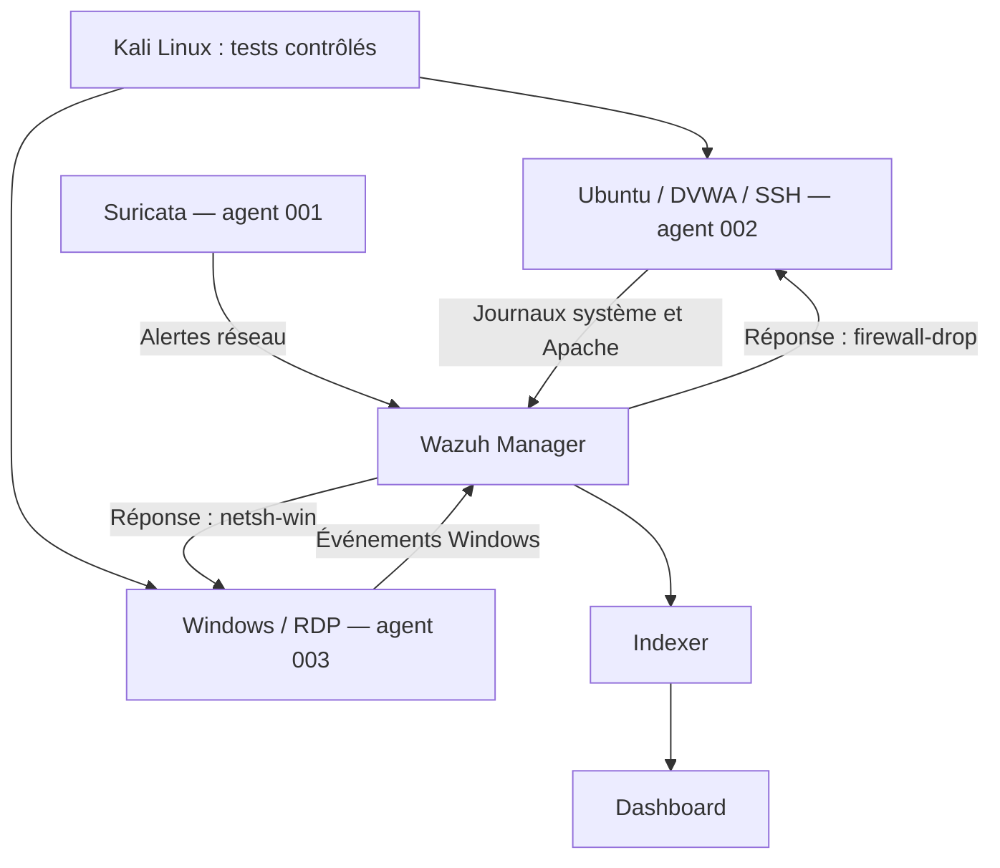

# Wazuh — Supervision de sécurité et réponse aux incidents

**5 scénarios détectés · 4 réponses automatiques · Linux et Windows**

Projet réalisé par **Zakaria Boukhris** dans le cadre d’un stage PFA d’un mois et demi à la **Direction provinciale de la Justice de Rabat**, en 2026.

L’objectif : centraliser les événements de plusieurs machines, détecter des activités suspectes et vérifier l’application d’une réponse automatique. Les expérimentations ont été réalisées dans un **laboratoire VirtualBox isolé**, distinct de l’infrastructure de production de l’organisme d’accueil.

## Travail réalisé

- Déploiement d’une plateforme Wazuh réunissant Manager, Indexer et Dashboard.
- Intégration de trois agents et des événements Linux, Windows et Suricata.
- Collecte des journaux Apache de DVWA pour la détection Web.
- Création de règles personnalisées pour SQL Injection et XSS.
- Validation de cinq scénarios et association aux techniques MITRE ATT&CK dans l’analyse.
- Automatisation du blocage temporaire avec `firewall-drop` sous Linux et `netsh-win` sous Windows.
- Diagnostic des incidents de configuration et mesure des délais observés.

## Architecture

Schéma logique des flux documentés ; les composants Manager, Indexer et Dashboard partagent la VM centrale. Le positionnement du capteur réseau est détaillé dans le rapport, sans déduire ici un mode de capture non documenté.

| Machine | Fonction |
| --- | --- |
| VM-SIEM-Central | Wazuh Manager, Indexer et Dashboard |
| VM-IDS-Suricata | Suricata 7.0.3 et agent Wazuh 001 |
| VM-Cible-Web | Ubuntu, DVWA, Apache, SSH, FIM et agent 002 |
| VM-Cible-Windows | Windows 11 Pro, RDP et agent 003 |
| VM-Attaquant | Kali Linux, outils de test dans le réseau isolé |

Les adresses privées visibles dans les captures appartiennent au réseau de laboratoire VirtualBox Host-Only `192.168.56.0/24` décrit dans le rapport.

## Résultats documentés

| Scénario | Règle Wazuh | Délai de détection rapporté | Réponse automatique | Délai après alerte rapporté |
| --- | --- | --- | --- | --- |
| Force brute SSH | 5763 | ≈ 7,7 s | Linux : firewall-drop | < 1 s |
| Scan Nmap | 86601, via Suricata | ≈ 1 s | Détection seule | Sans objet |
| Force brute RDP | 60204 | ≈ 17 s | Windows : netsh-win | ≈ 1 s |
| Injection SQL | 100010, personnalisée | Non consolidé | Linux : firewall-drop | ≈ 1 s |
| XSS réfléchi | 31106 puis 100011, personnalisée | Non consolidé | Linux : firewall-drop | ≈ 1 s |

Le timeout de blocage configuré est de **600 secondes**. Dans ce laboratoire, la règle Nmap de niveau 3 n’est pas utilisée pour déclencher un blocage automatique.

Le rapport nomme ces indicateurs **MTTD** et **MTTR**. Ici, le second mesure le temps entre l’alerte et l’application de la contre-mesure, et non la résolution complète d’un incident. Ces valeurs sont des observations du laboratoire ; le nombre de répétitions et la dispersion ne sont pas établis dans cette publication. Elles ne constituent pas un benchmark de production.

## Aperçu des preuves

### Détection d’une injection SQL

Le Dashboard est filtré sur la règle personnalisée `100010` et présente des alertes de niveau 10.

### Configuration de la réponse automatique

Extrait visuel des quatre associations règle/action et du timeout. Cette capture est un extrait du rapport, pas un fichier de configuration complet à déployer.

**[Voir les sept captures commentées](docs/preuves.md)**

## Démarche et retour d’expérience

La validation croise l’alerte, le journal Active Response, l’état du pare-feu et l’effet côté machine de test. Une simple interruption d’un outil de test ne suffit pas à attribuer le blocage à Wazuh.

- **Windows :** adaptation de la réponse au mécanisme disponible sur l’agent, avec `netsh.exe`.
- **Fiabilité des essais :** vérification des blocages résiduels avant de rejouer un scénario.
- **Mesure :** prise en compte du décalage entre l’heure du navigateur et les journaux UTC.
- **Observabilité :** consultation des journaux locaux Active Response lorsque l’action n’est pas visible dans le Dashboard.

[Déploiement et validation documentés](docs/demarche.md) · [Limites et améliorations](docs/limites.md)

## Contenu du dépôt

Ce dépôt présente une **étude de cas technique** : synthèse, architecture, résultats et captures extraites du rapport de stage. Il ne contient pas d’images de machines virtuelles, d’exports complets des configurations ou de scripts originaux de réponse. Il n’est donc pas une installation automatisée reproductible en une commande.

Le rapport intégral n’est pas inclus dans cette édition publique. Les sept captures retenues présentent le laboratoire et ses alertes, sans publier les captures de mots de passe ou de cookies de session présentes dans certains scénarios du rapport.

## Source

Rapport de stage PFA de Zakaria Boukhris, *Déploiement d’une infrastructure SIEM avec Wazuh et automatisation de la réponse aux incidents de sécurité*, année universitaire 2025–2026. Les renvois détaillés aux pages et figures figurent dans la documentation.
