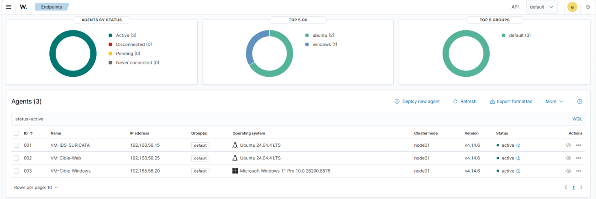
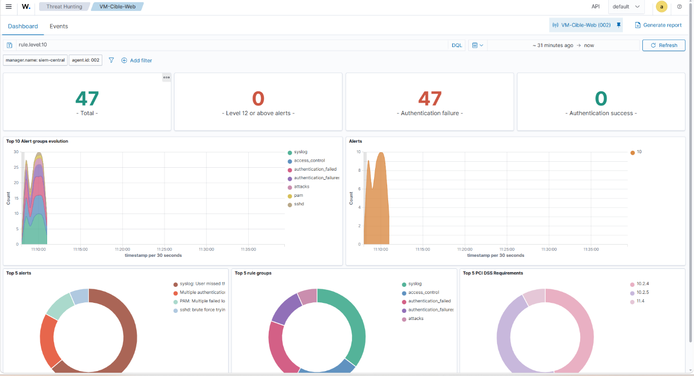
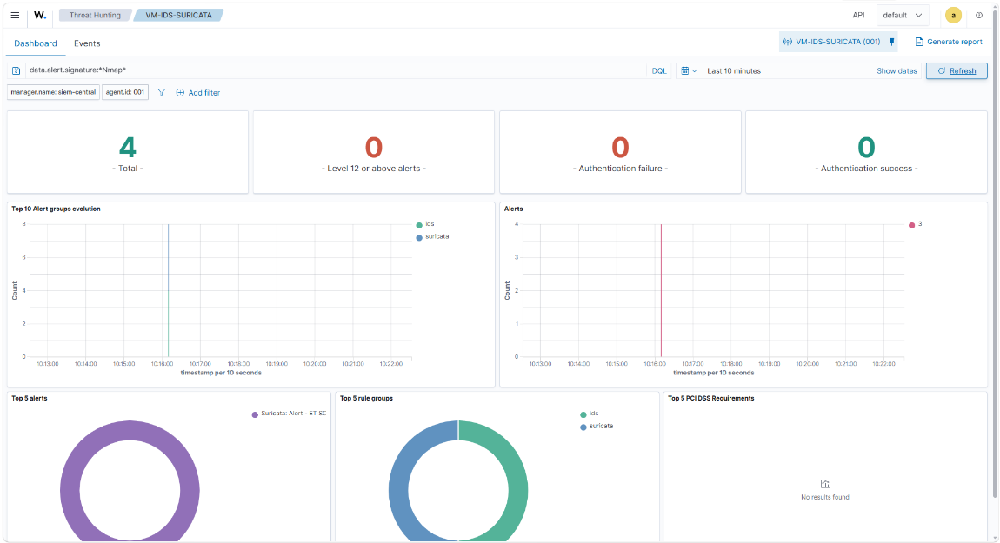
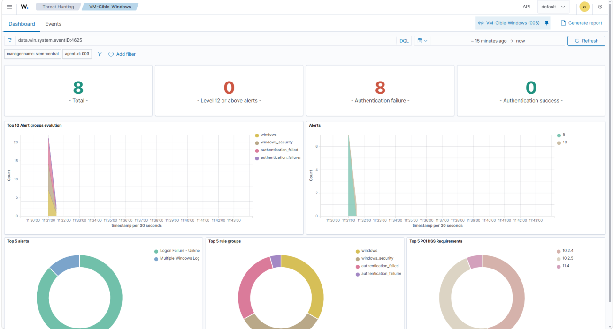
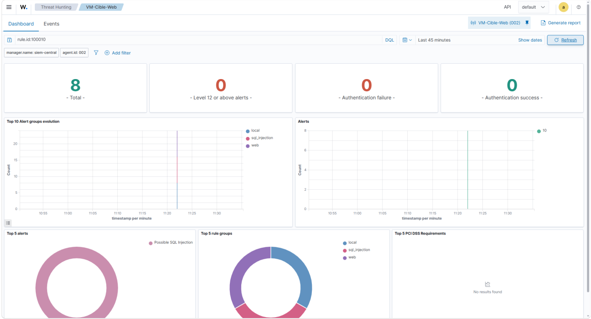
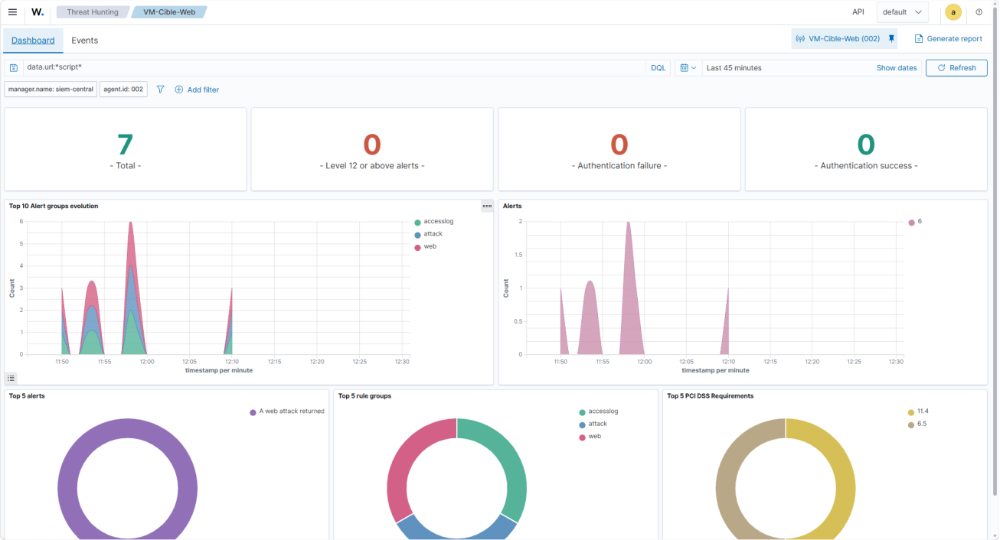
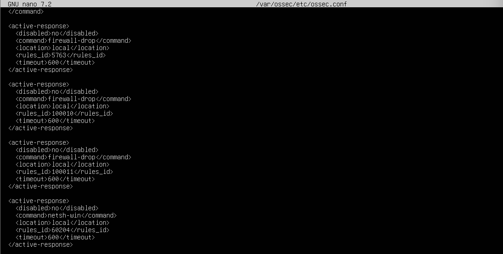

# Captures et portée des preuves

[Retour à la présentation](../README.md)

Les images sont extraites du rapport de stage, sans recréation des interfaces ni modification des résultats affichés. Les numéros ci-dessous correspondent aux pages imprimées du rapport. Une capture de Dashboard illustre les événements affichés ; elle ne suffit pas, seule, à établir le délai de détection ou l’exécution d’un blocage.

## 1. Agents actifs — page 24, figure 6

Trois agents sont actifs : Suricata, cible Web Ubuntu et cible Windows. La version d’agent affichée est 4.14.6 ; cette capture ne prouve pas à elle seule la version de tous les composants du serveur.

## 2. Force brute SSH — page 27, figure 12

Le Dashboard de la cible Web affiche des échecs d’authentification, avec un filtre de niveau 10. Le rapport rattache ce scénario à la règle 5763.

## 3. Scan Nmap — page 28, figure 14

Les événements sont filtrés sur la signature Nmap pour l’agent Suricata. Le rapport décrit la règle 86601 et un scénario limité à la détection.

## 4. Force brute RDP — page 30, figure 16

La capture de la cible Windows est filtrée sur les événements 4625. Elle illustre les échecs de connexion ; l’attribution à la corrélation 60204 repose sur l’analyse du scénario dans le rapport.

## 5. Injection SQL — page 32, figure 18

La règle 100010 apparaît dans le filtre ; les événements de niveau 10 relèvent de la collecte Web et de la règle personnalisée.

## 6. XSS — page 33, figure 20

Cette capture montre la phase de détection native, de niveau 6, avec un filtre sur les requêtes contenant `script`. Le rapport distingue cette phase de la règle personnalisée 100011 de niveau 10 utilisée ensuite pour l’Active Response. Cette image ne montre donc pas directement les alertes de la règle 100011.

## 7. Active Response — page 34, figure 21

L’extrait associe les règles SSH, SQLi et XSS à `firewall-drop`, et RDP à `netsh-win`, avec un timeout de 600 secondes. Il montre la configuration, pas l’exécution ni une preuve complète de blocage. Les validations d’exécution sont décrites aux pages 34 à 37 du rapport.

## Provenance et sélection

Les adresses et noms de VM visibles sont ceux du laboratoire décrit aux pages 22–24. Les captures publiées ont été relues visuellement : aucun mot de passe, cookie de session ni donnée métier n’y a été repéré. Les captures d’extraction de données, de cookies et de listes de mots de passe n’ont pas été retenues.
